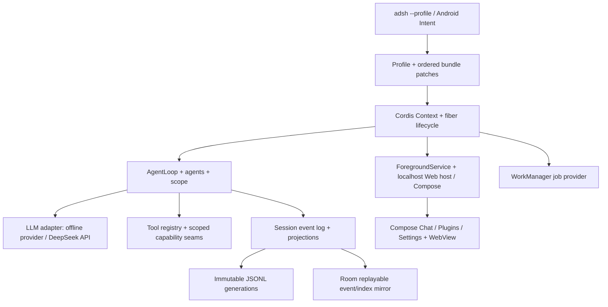

# Android dsh 架构草案

状态：已确认的目标架构；当前 APK 的实际功能与待实现项见 [实现状态](../README.md)。目标包名 `com.example.adsh`，Android 10+ / arm64-v8a。本文按 [原架构](../../upstream/docs/architecture.md) 的章节组织；精确事件签名以 [事件表](../../upstream/docs/event-producer-consumer.md)、[生命周期](../../upstream/docs/agent-lifecycle.md) 和包级 README 为准。

## Cordis

Android 的 `Context` 是按 key 注入的 Service 仓库；AgentLoop、LLMAdapter、SessionStore、ToolRegistry 均由插件提供。插件声明 `inject`，依赖可用后才执行 `apply(ctx)`。每次注册归所属 fiber 管理，`effect` 收集 disposer，卸载时逆序释放并等待异步资源结束。事件声明包含名称、载荷与唯一分发模式：`emit` 同步通知，`waterfall` 同步/异步包装下游并允许短路，`parallel` 并发等待，`serial` 顺序等待，`bail` 以第一个有效返回值结束；包装监听器调用 `next()` 才委托下游。作用域跟随 agent 的子 Context，避免跨会话泄漏。

Android 容器只负责 Service 生命周期和服务发现；业务行为放在可替换的 Provider 插件中。Service key、事件 mode、注册归属与卸载顺序由同一 SDK 定义统一约束，参见 [Plugin SDK 草案](plugin-sdk-android.md)。

## Profiles and bundles

`filesDir/dsh-home/profiles/<name>/` 保存 `package.json`、`cordis.yml`（解析后的入口树）、`cordis.patch.yml` 和 `compatibility.json`；home 根目录保存用户补丁。`package.json` 的 `dsh.profile.bundles` 是有序 bundle 名单，bundle 的 `dsh.bundle.patch` 指向一个或多个有序 patch 文件。每次启动从空树依次应用 bundle、profile patch、home patch、命令行 `--patch`。patch 用 `id` 指定行，`config` 为整项替换；`insert` 插入新行，preset patch 进入声明行的 `config.plugins`。`cordis.yml` 是这棵树的可检查表示，启动真相来自按顺序解析的 layers；`adsh --profile web --dump-config` 输出最终树与跳过的 bundle 诊断。

内置模板为 `web = base + web-app`、`headless = base + headless`、`sdk = base + sdk-app`、`acp = base + acp-app`、`sdk-minimal = sdk-minimal`。base 汇集模型、工具、持久化、沙箱/审批、设置、凭证与遥测。web 的配置 HMR 默认启用，其余关闭；Kotlin fiber 可重挂，已加载的 Android 代码升级按 `restart-required` 处理。profile 安装态、包存储 `filesDir/packages/` 与各端激活/锁分开；CLI 与应用共享用户数据，分别持有写锁与安装元数据。



## Application launch

唯一应用启动路径是 `adsh --profile <name>`。`MainActivity` 的 task intent 解析为 profile + 排队用户输入，再交给同一启动器；headless 单次执行、sdk JSON-RPC、acp 服务都由对应 profile 挂载。前台常驻开关管理 ForegroundService；后台任务交 WorkManager。Web 默认仅监听 `127.0.0.1:3080`，端口占用报告启动失败；localhost 端点沿用 Web 的鉴权、权限与流协议语义。网络、通知等权限按动作动态申请，电池优化提示由用户选择。

## Desktop application

桌面 Host 映射为 Android ForegroundService + WebView；Compose 实现 Chat 节点、Plugins 侧栏与 Settings 卡片，沿用事件和 RPC 投影。Web 静态资源从已校验本地包读取，WebView 只开放最小原生桥接接口。敏感屏图像留在设备；用户选择上传时使用 Keystore 管理的密钥加密本地文件并通过加密传输发送。支付与隐私变更进入人工审批；截图与任务描述的训练授权默认关闭。

## Core packages

| 原包 | Android Service / 责任 |
|---|---|
| `core/session` | `sessions`：append-only SessionEvent、内存 store、`deriveMessages()` |
| `core/system-prompt` | `systemPrompt`：section、context 和 tool schema 组装 |
| `core/tools` | `tools`：作用域注册、pre/execute/post 流水线 |
| `core/agent` | `agents`：Agent 接口、live registry、agent 事件 |
| `core/agent-loop` | `agentLoop`：可替换的默认 turn 驱动 |
| `core/scope` | Agent 子 Context 的隔离注册工具 |
| `llm/llm` | `llm`：消息/stream 词汇和可替换 adapter |

DeepSeek adapter 提供流式输出与断线重连处理；断线期间已提交的输入和 settlement 由 Session 恢复。离线模式挂载本地 Provider 或保留已存会话阅读能力；其模型资产、推理接口与内存预算在后续实现前单独验收。

## Events

持久 `session/event` 记录事实；实时 `agent/*` 传递执行状态；`fs/*`、`tools/*` 等能力事件挂策略。事件声明严格绑定 mode；`agent/pre-step`、`agent/request`、`llm/stream` 与 `tools/pre-execute` / `tools/execute` / `tools/post-execute` 为 waterfall，`agent/turn-stopping` 为 serial。异步 `agent/created` 完成后开始排队工作；失败则撤销初始化。完整签名以原包事件声明和[事件表](docs/event-producer-consumer.md)校对。

## Turn flow

```text
turn/start -> claim next-step + one queued input
  -> assemble prompt + tool schemas -> agent/pre-step
  -> reject / empty first input: turn/end (zero steps)
  -> step/start -> agent/request -> prepareCall
  -> reconcile system/message -> append admitted user/message
  -> reconcile runtime context -> request/header + request/context (when needed)
  -> deriveMessages + freeze -> bound stream through llm/stream
  -> agent/assistant-stream start/chunks
  -> assistant/message | assistant/attempt -> committed stream end
  -> tool/call -> tools/pre-execute -> tools/execute
  -> tools/post-execute -> tool/result -> step/end
  -> pending tools or new input: next step
  -> agent/turn-stopping -> turn/end
```

`prepareCall` 与 `agent/request` 的异步取消发生在 system/user 提交之前。失败、重试、取消的已结算尝试写 `assistant/attempt`，且不进入模型历史；成功的 `assistant/message` 内嵌精确紧凑 timed stream。工具结果依模型调用顺序提交；重试复用已组装 prompt 和 pre-step 决策，避免重复写用户消息。持久事件与 live stream 的归属参见[原时序图](../../upstream/docs/agent-lifecycle.md)。

## Session log

逻辑 SessionEvent 是模型历史的唯一依据。JSONL 的 v0 文件名为 `session.jsonl[.zstd]`，后继为 `session.vN.jsonl[.zstd]`；按规范文件名选数值最大 generation。`open` 校验版本及事件，按相邻迁移链解码；写打开先编码、验证并排他发布新 generation，保留所有已提交文件。未知事件仅在信封显式 `ignorable: true` 且格式迁移允许时保留；模型可见扩展先写事件，再由纯投影变成消息。

Android 的 Room 保存可查询 SessionEvent 镜像、header/index 与投影快照；JSONL 是 generation 发布与跨端回放的持久基准。单 Session 写锁串行化追加：先持久提交 JSONL（含 flush/sync），再在 Room transaction 中提交对应 event rows 与索引；启动时比较 seq/校验摘要，按 JSONL 补齐 Room 缺口。Room `SCHEMA_VERSION` 单调递增，schema migration 与 JSONL format migration 分开。`ctx.sessionProjections.register` 增量折叠事件，`stateOf` 与 `snapshot` 读取已提交态；AgentLoop 注册 `turnBoundary`。断网重连和进程崩溃以 log replay 恢复一致性。

## Capability seams

每项能力具有 Service Definition、Provider 与 Consumer。执行世界共用一个可替换的沙箱根：`shell` / `subprocess` / `terminal` / `fs` / `lsp`；Android 本地实现经 Process 与私有文件目录，切换 Provider 时整体迁移。`skill`、`web` search/fetch、`compaction`、`context`、`subagent`/Agent Teams、`bundle`、`workflow`、`webhook`、`todo`、`plan`、`preset`、`guard`、`self-modification`、`hooks`、`session` persistence/title/telemetry、`identity`、`settings`、`credentials`、`acp`、`interaction`、`boot`、`sdk`、`jobs` 均遵循三角色结构；工作流与 jobs 的 Android Provider 使用 Coroutine Worker。preset 的 service 行使用 isolate realm。交互审批由宿主确认并通过服务记录决定，低沙箱、高风险行为必须等待弹窗确认。

Plugin Manager 按原接口返回 bundles 的 meta/description/source/availability/installed/official/optional/error；inspect 识别 registry/path/git/tarball；安装需校验包与版本、精确保存依赖、按顺序轮询 registry、git 先做连通性检查；提供 install-state/log、cancelInstall、waitForInstall、pendingBuilds 脚本审批。enable/disable 仅写 disabled 的最小差集补丁，移除先卸载 effect 再移除包。`compatibility.json` 豁免限定精确包版本和运行时版本，要求 `acceptRisk` 与显式风险提示；无 HMR 报 `restart-required`。安装存储格式、TS 依赖解析及 Android 动态代码装载需在 M4 前完成安全与兼容性实测。

## Where new behavior goes

| 目的 | 接口 |
|---|---|
| 模型适配 | `ctx.llm` |
| 模型工具 | `ctx.tools`，schema 参与 prompt 组装 |
| 命令与后台作业 | `ctx.commands`、`ctx.jobs` |
| Webhook 入口 | `ctx.webhookRuntime` 的可信规则 |
| 单 Agent 注册 | `agent.ctx` 子作用域 |
| 模型可见上下文 | `agent.inject()`，下一次获准请求写 log |
| 持久插件态 | `SessionEventMap` 扩展、projection 和回放 |
| UI 对话节点 | keyed ConversationNodeDefinition 与 renderer |

## 评审决定与验收路线

M1：profile/bundle 解析与 dump-config、Room/JSONL 一致性、设置/凭证；M2：turn 流、DeepSeek stream、tools 与 shell/terminal/fs；M3：其余能力 Provider/Consumer 与审批；M4：Plugin Manager、Kotlin/TS SDK、示例、headless/sdk/acp；M5：离线、功耗、长会话、连续 1 小时不丢 log 的回归。测试从真实 profile 启动，覆盖断线重连、失败恢复、bundle 禁用与 fiber 卸载后 effect 清零。

请先确认三项方案：Room 与 JSONL 的权威/镜像关系；Kotlin 外部插件采用已安装 APK 的受信任 ClassLoader 与显式用户授权；TS 包先离线编译成受限 JS 模块，并以兼容性测试锁定允许的 Node API、模块格式和平台 ABI。这三项会影响持久格式、安装协议与安全审批，确认后进入 M1/M2。
