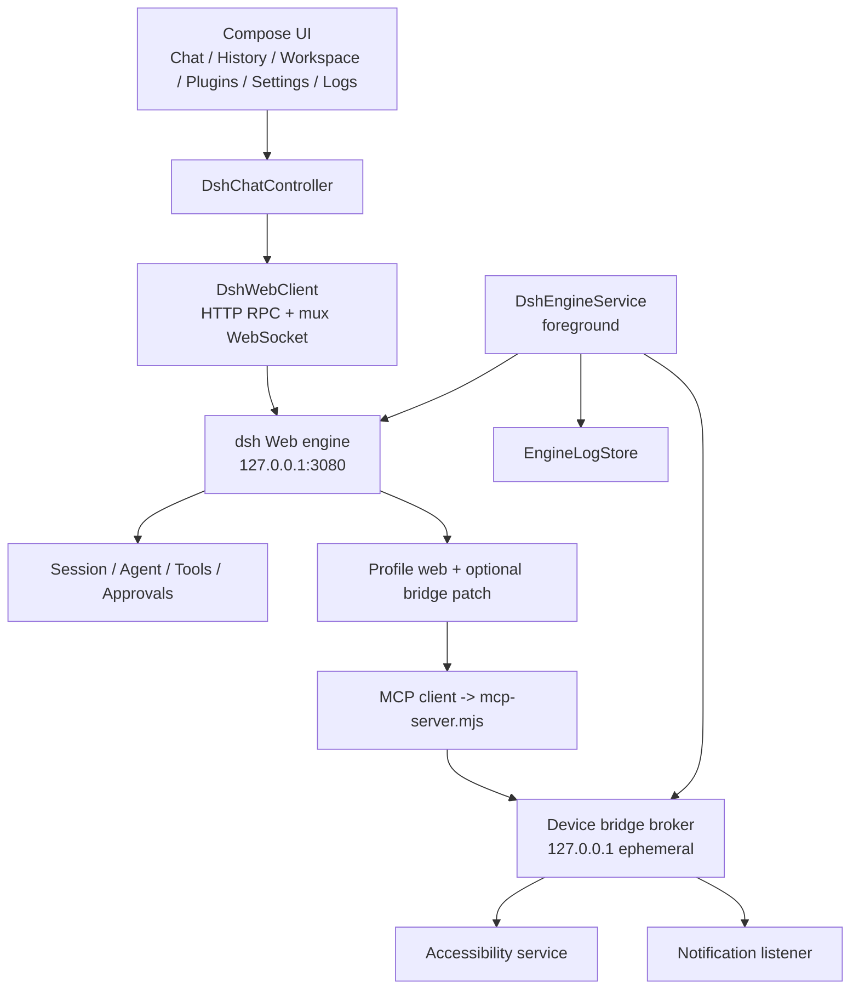

# Android 架构与实现

状态：与当前 APK 一致。功能验收证据见[对齐状态](parity-status.md)，构建与运行见[README](../README.md)。目标包名 `com.example.adsh`，Android 10+ / arm64-v8a。

## 总体结构

应用内只有一个对话真相源：随附的 dsh Web 引擎。Compose 不再是聊天协议客户端，而是该引擎的本地客户端。

## 引擎启动与登录

`DshEngineService` 是 `startForeground` 服务，负责：

1. 校验内置 payload 的 SHA-256，解压到 `filesDir/dsh-runtime/runtime-<sha>/`，确保 Node 可执行。
2. 需要时把 `assets/dsh-bridge/mcp-server.mjs` 复制到私有目录，启动设备桥 broker，写入 `android-bridge.cordis.yml`。
3. 以 `node --expose-internals bin.js --profile web [--patch <abs>] --no-open` 启动引擎，工作目录与 home 均位于应用私有目录。
4. 从 stdout 解析 `http://127.0.0.1:3080/?token=…`，用带 token 的 `GET /` 建立登录 Cookie；未认证 `GET /` 返回 200/401 即视为就绪。
5. 把 stdout/stderr、退出码、崩溃归因写入 `EngineLogStore`（JSONL，token 脱敏）。

安全模式使用 `--profile rescue --from-default-profile web`，从随附 Web 模板重建干净配置，并同样附加设备桥 patch（若启用）。

`targetSdk` 固定为 28，原因是随附 Node ELF 需要在应用私有目录获得可执行权限；升级平台目标前必须重新验证运行时。

## 网络协议

`DshWebClient` 同时维护两条通道：

- 一元 RPC：`POST /api/<endpoint>`，请求体为 `{"type":"client-request","rpcId","method","payload":{"args":…}}`，响应为 `{"type":"server-response","result":{"ok":true,"value":…}}`。
- 多路 WebSocket：`/api/remote.mux`。客户端发送 `open` / `item` / `end` / `cancel`，宿主回 `value` / `end` / `error`。`$events` 流用于 `emit`、`waterfall`、`cancel` 事件。

重连策略为 `500ms, 1s, 2s, 4s, 8s, 10s` 加抖动；重连后重开全部流，并按 `eventId` 去重待处理的审批/提问。

会话操作包括 `session/list`、`session/create`、`session/prompt`、`session/follow`、`session/cancel`、`session/modelCatalog`、`session/selectModel` 与 `credentials/set`。follow 流按 `snapshot` / `event` / `assistant-stream` 帧更新 UI。

## 会话状态与 UI 投影

`DshChatController` 是唯一持有聊天状态的组件：

- 维护会话列表、当前会话、模型目录、选中模型/推理强度、运行态、流式文本、工具调用、用量、审批/提问队列与错误。
- 把 follow 流的持久事件投影为消息列表；工具调用与结果按调用 ID 合并。
- 发送时先确保会话存在，再 `prompt`；取消调用 `session/cancel`。
- 切换会话时重新 follow；引擎重启或 mux 重连后自动恢复。
- 应用回到前台（`ON_START`）时重新订阅当前会话，以新 `snapshot` 校正消息，弥补后台期间可能丢失的流事件。
- 审批回写 `{"kind":"result","value":"allowed-once"|"rejected"}`；提问回写 `{"kind":"result","value":{"answers":[…]}}`。

UI 层只消费 `DshChatState`，不直接解析引擎帧。

## 引擎生命周期

- 崩溃重启：`EngineRestartPolicy` 以 1 秒、2 秒间隔重启；连续 3 次异常退出后停止并给出中文提示。
- 空闲停止：`EngineIdlePolicy` 在应用退到后台且无运行任务 5 分钟后请求停止，节省电量。前台状态由 `MainActivity.onStart/onStop` 在绑定/解绑前后直接写入服务，避免 `ON_STOP` 时 binder 已释放导致 `foreground` 永远为真。
- 日志：`EngineLogStore` 追加写入并限制内存窗口；日志页每 1.5 秒轮询，支持刷新、清空、复制与错误/警告着色。
- 设置页通过 Binder 暴露启动、停止、重启、当前端口与日志路径。

## 设备能力桥

设备桥是 Android 专属扩展，默认关闭，用户在设置页显式开启：

1. `DeviceBridgeServer` 绑定 `127.0.0.1` 的临时端口，使用 32 字节 `SecureRandom` token、常量时间比较；请求体上限 1 MB，超时 10 秒。
2. `DeviceBridgeConfig` 生成独立的 `--patch` 叠加文件，插入 `@deepseek-ai/dsh-mcp-client` 行；不修改用户的 `profiles/web/cordis.patch.yml`。
3. `mcp-server.mjs` 是零依赖 MCP stdio server，拒绝 `server/discover` 后走 2025-06-18 初始化；工具名映射为 `mcp__adsh_device__*`。
4. broker 路由：`/device`、`/notifications`、`/ui`、`POST /ui/tap|swipe|text`、`POST /app/open`、`/apps`、`POST /actions/alarm|timer|sms|sms/send|dial|speak|speak/stop`。
5. 无障碍服务提供界面树、点击、滑动与文本输入；通知监听服务提供通知列表。
6. 自动化动作：闹钟与计时器通过系统公开 Intent 直接创建；`compose_sms` 与拨号只打开系统应用并预填；`send_sms` 经 `SmsManager` 直接发送，需要单独授予“短信发送”运行时权限，且只在用户明确要求发送时调用。`send_sms` 为每个分片注册一次性 `SMS_SENT` 广播并等待最多 15 秒（从调用开始计时，包含系统确认耗时），把 `RESULT_OK` 或运营商错误码汇总成“发送成功/失败/未收到完整回执”。一加/ColorOS 会在系统层再弹一次发送确认（约 8 秒倒计时），由用户在手机上点“发送”，应用不自动点击或绕过该确认；朗读复用 `ReplySpeaker`。
7. `DeviceCapabilities` 保留最近 30 条审计，设置页展示最近 6 条。
8. 关闭开关会删除 patch、停止 broker、重启引擎；引擎未运行时仅保存设置。

MCP 子进程环境会清除凭据型变量与 `DSH_*`，设备桥 token 只通过配置的 `config.env` 注入，因此不会出现在父进程环境或引擎日志中。

真机上已逐一调用原有 7 个工具：`device_info`、`notifications_list`、`screen_snapshot`、`screen_tap`、`screen_swipe`、`screen_input`、`app_open`；新增的 `list_apps`、`set_alarm`、`set_timer`、`compose_sms`、`send_sms`、`dial_number`、`speak_text`、`stop_speaking` 已完成 MCP `tools/list` 与 broker 端点冒烟；`send_sms` 在模拟器上真实写入系统已发送库，模拟器与真机均通过 `SMS_SENT` 广播返回“发送成功”。重装 APK 后系统可能清空无障碍/通知授权，需要重新开启；运行时的 `android_a11y_status` 可能滞后，以本应用设置页和实际桥调用为准。桥的坐标系为应用内容区高度（真机 1240×2479），不是含系统栏的物理高度。

## 语音、唤醒与自动化

- `SherpaSpeechRecognizer.kt` 是默认的普通话引擎：sherpa-onnx 流式 Zipformer（int8，`assets/sherpa/model`）逐 100 ms 出部分结果，Silero VAD 负责免按住端点，CT-Transformer 只对最终文本加标点；热词按行传入 `createStream`，加载时按 `tokens.txt` 过滤含未登录字的行。默认开启二次解码：录音缓存最多 30 秒，松手后用 Paraformer small int8（`assets/sherpa/paraformer`，78 MiB）重解整句，流式结果作为回退；离线模型在 `prepare()` 后由独立线程预热。模型直接从 assets 映射（`noCompress` 保证 `Stored`），不复制到私有目录。`decodePcm()` 供 instrumentation 直接解码 WAV。
- `SpeechTextNormalizer.kt` 做保守 ITN：只转换语境明确的日期、时刻、百分比、序数与带单位数量，“一起”“十分高兴”“第一时间”等歧义用法保持汉字；只作用于最终文本，可在设置页关闭。
- `OfflineSpeechRecognizer.kt` 保留 Vosk 回退：首次把 `assets/vosk/model-cn`（`vosk-model-small-cn-0.22`，65 MiB）复制到 `filesDir/vosk/model-cn` 并加载 `Model`，用 `AudioRecord` 直录并流式识别；`decodePcm()` 同样供测试使用。
- `VoiceInputController` 统一三种引擎与回调：普通话且资产齐全时“自动”走 sherpa，否则系统 `SpeechRecognizer`，再否则 Vosk；粤语只走系统。进入对话页会后台 `prepare()` 预热流式模型与二次解码模型，最终文本按设置执行 ITN。TTS 仍由 `ReplySpeaker` 负责（按助手消息去重，只朗读已完成的回复）。细节见[本地增强语音识别](sherpa-offline-speech.md)与[离线语音识别](vosk-offline-speech.md)。
- `AdshAccessibilityService` 额外维护可选的悬浮球：`TYPE_ACCESSIBILITY_OVERLAY` 不需要悬浮窗权限，轻点通过 `MainActivity.EXTRA_VOICE_START` 打开对话并发起语音，长按只打开对话，拖动位置写入 `adsh_wake` 偏好。
- `AutomationStore` 用 SharedPreferences 保存一键任务；`AutomationScreen` 负责创建、删除与执行，执行即把任务内容发送给当前引擎。
- 远程引擎：`SecureSettings` 用 AndroidKeyStore 加密保存电脑端 `dsh web` 的 token 地址；`DshChatController.attach` 与本地引擎共用同一 HTTP/WebSocket 客户端。启用远程地址后本机引擎可保持停止。
- 明文 HTTP 仅用于局域网或本机调试，网络安全配置允许明文；跨网络使用时应通过 HTTPS 隧道。

## 主题与布局

- `ui/Theme.kt` 提供 `ThemeMode { SYSTEM, LIGHT, DARK }`、Material 3 浅色/深色配色、中文字体行高、形状与系统栏外观。
- 状态栏与导航栏设为透明，由应用表面延伸到系统栏区域；同时按深浅色切换图标明暗，并关闭对比度强制着色。
- 选择持久化在 DataStore（`theme_mode`），重装应用后仍保留。
- 文案资源使用应用专属键名（如 `profile_selected_suffix`），避免依赖库在 `zh-Hant-HK` 等同名资源上覆盖应用默认值。
- 统一 4dp 栅格、16dp 页面边距、20dp 卡片圆角、28dp 弹层圆角。
- 对话、历史、工作区、插件、设置、日志都覆盖加载、空与错误态；已按 360dp 宽 + 1.3 倍字体验证无横向溢出。

## 目录索引

| 路径 | 职责 |
|---|---|
| `MainActivity.kt` | 导航、主题、设置页、工作区选择、引擎生命周期 UI |
| `ChatScreen.kt` | 对话、历史、消息与工具卡片、审批/提问、空态建议、语音输入与朗读 |
| `EngineLogScreen.kt` | 日志控制台、复制/清空/重启/安全模式 |
| `HistoryWorkspaceScreens.kt` | 工作区页面与旧历史页（已被引擎历史页取代） |
| `DshEngineService.kt` | 前台服务、启动参数、payload、崩溃/空闲策略 |
| `engine/DshWebClient.kt` | 登录、RPC、mux、重连、follow 流 |
| `engine/DshChatController.kt` | 聊天状态机与事件投影 |
| `engine/DshWire.kt`、`DshJson.kt` | 协议帧与 JSON 边界 |
| `engine/EngineLogStore.kt`、`EngineCrash.kt` | 日志持久化与崩溃归因 |
| `engine/EngineRestartPolicy.kt`、`EngineIdlePolicy.kt` | 重启与空闲策略 |
| `device/*` | broker、MCP patch、无障碍/通知服务、悬浮球、审计 |
| `VoiceController.kt` | 语音门面：`VoiceInputController`（sherpa 优先、系统与 Vosk 回退）与 `ReplySpeaker`（TTS 播报） |
| `SherpaSpeechRecognizer.kt` | sherpa-onnx 流式模型加载/录音会话/VAD/热词/标点/Paraformer 二次解码、`decodePcm()` 测试入口 |
| `SpeechTextNormalizer.kt` | 最终文本的保守逆文本规整（日期/时间/百分比/数量） |
| `OfflineSpeechRecognizer.kt` | Vosk 模型加载/录音会话/部分结果与最终结果、`decodePcm()` 测试入口 |
| `assets/sherpa/` | 流式 Zipformer、Silero VAD、标点、Paraformer 二次解码模型与热词（模型 gitignore，`tools/fetch_sherpa_models.py` 生成） |
| `assets/vosk/model-cn/` | Vosk 中文模型（gitignore，`tools/fetch_vosk_model.py` 生成） |
| `AutomationStore.kt`、`AutomationScreen.kt` | 一键任务存储与自动化页面 |
| `ui/Theme.kt` | 主题、字体、形状 |
| `assets/dsh-bridge/mcp-server.mjs` | 零依赖 MCP stdio server |
| `assets/dsh/payload.zip` | 内置 Node/dsh 运行时 |

## 与旧实现的关系

早期版本的 `DeepSeekClient`、`LlmRegistry`、`LocalSessions`、`SessionDatabase`、`MessageProjection`、`SessionPresentation`、`SessionWorkspaceLink`、`ModelRoutePicker` 与 `ModelSelection` 已被引擎链路取代，源码与对应单测已移出构建。历史遗留文件备份在开发机的 `/tmp/dsh-legacy-backup`，不随仓库分发。

旧 `HistoryScreen` 也已被 `EngineHistoryScreen` 取代，仅保留在 `HistoryWorkspaceScreens.kt` 中的工作区页面仍在使用。

## 后续方向

- 把插件页、模型供应商、统计与轨迹从原版 Web 迁移为 Compose 原生视图。
- 统一引擎设置与本地设置，补齐凭据轮换、审计导出与多工作区支持。
- 继续在更多厂商 ROM 上验证无障碍/通知权限的持久性、后台限制与敏感信息遮罩。
