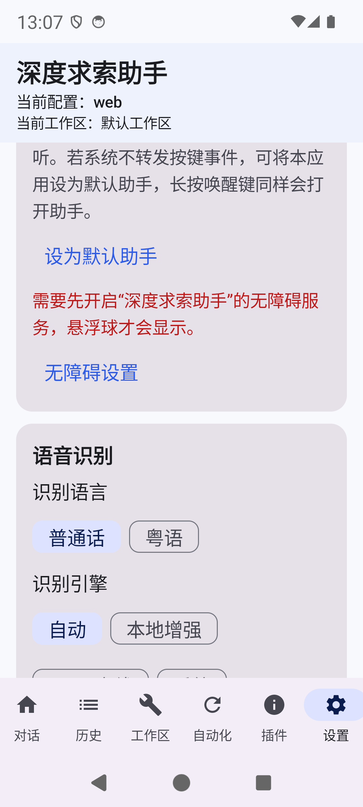
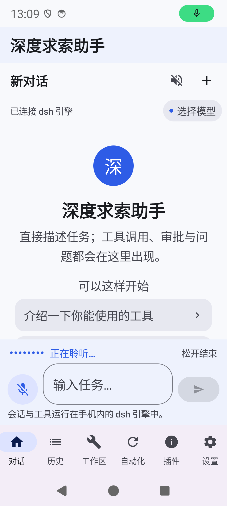

# 本地增强语音识别（sherpa-onnx）集成与验证

状态：2026-11-09 完成接入与模拟器验证。默认“自动”引擎在普通话下优先使用本方案，系统 `SpeechRecognizer` 与 Vosk 保留为回退。设置页“识别引擎”可选“自动 / 本地增强 / Vosk 离线 / 系统”，语言可选普通话或粤语。架构总览见[架构与实现](architecture-android.md)，Vosk 回退见[离线语音识别（Vosk）](vosk-offline-speech.md)。

## 1. 选型

| 方案 | 许可证 | 集成方式 | 模型体积 | 流式上屏 | 结论 |
|---|---|---|---|---|---|
| **sherpa-onnx 2.0.1 + streaming Zipformer int8** | Apache-2.0 | 官方 GitHub Release AAR，arm64-v8a，无需本地 NDK 构建 | 约 168 MiB（encoder/decoder/joiner） | 支持，约 100 ms 粒度 | **采用**：本地、低延迟、可热词偏置 |
| 系统 `SpeechRecognizer` | 系统服务 | 无模型 | 0 | 依赖厂商实现 | 保留：粤语唯一可用路径 |
| Vosk small-cn | Apache-2.0 | Maven AAR + 65 MiB 模型 | 65 MiB | 支持 | 保留：无系统服务时的普通话兜底 |

相比 Vosk，小模型对专有名词（“达摩院”）和同音词更容易出错；sherpa 的流式 Zipformer 在中文通用场景精度更高，并且支持热词、VAD 端点检测和标点模型。

## 2. 组件

| 组件 | 说明 |
|---|---|
| `app/libs/sherpa-onnx-2.0.1.aar` | 47 MiB；含 `libonnxruntime.so`、`libsherpa-onnx-{c-api,cxx-api,jni}.so`，仅打包 `arm64-v8a` |
| `assets/sherpa/model/` | `encoder.int8.onnx`（153.7 MiB）、`decoder.onnx`、`joiner.int8.onnx`、`tokens.txt`（2002 个 token） |
| `assets/sherpa/vad/silero_vad.int8.onnx` | 208 KiB，Silero VAD，用于免按住模式与静音端点 |
| `assets/sherpa/punct/model.int8.onnx` | 72 MiB，CT-Transformer 中英标点模型，只在最终文本上跑一次 |
| `assets/sherpa/hotwords.txt` | 一行一个短语；随仓库跟踪，可按需增删 |
| `SherpaSpeechRecognizer.kt` | 模型加载、麦克风会话、流式解码、VAD、标点、回调 |
| `VoiceController.kt` | 引擎选择与统一回调；进入对话页时后台预热模型 |

`androidResources { noCompress += listOf("onnx", "txt") }`：`AAsset_getBuffer` 要求资产以 `Stored` 方式入包，不能压缩。APK 中这 7 个文件均验证为 `Stored`。

## 3. 解码链路

- `AudioRecord(VOICE_RECOGNITION)`，16 kHz、单声道、PCM16，`NoiseSuppressor` + `AutomaticGainControl`，每 100 ms（1600 采样）送入一次。
- `FeatureConfig(sampleRate=16000, featureDim=80, dither=0)`；`OnlineModelConfig(..., modelingUnit="cjkchar")`；`decodingMethod="modified_beam_search"`、`maxActivePaths=4`、`hotwordsScore=1.5`。
- 热词以 `cjkchar` 编码，通过 `createStream(hotwords)` 逐流传入。模型词表只有 2002 个 token，包含未知字符的热词会让 sherpa 跳过**全部**热词，因此加载时先按 `tokens.txt` 过滤整行。
- 免按住（VAD）模式：`minSilenceDuration=0.45s`、`minSpeechDuration=0.25s`；连续静音 500 ms 且已检测到 ≥300 ms 语音后自动结束，8 秒无语音则提示“没有检测到语音输入”。
- 最终文本调用 `OfflinePunctuation.addPunctuation()`，流式阶段不跑标点，避免增加每帧开销。
- 回调统一切回主线程：`onPartial` / `onFinal` / `onError` / `onListeningChanged` / `onLevel(0..1)`。

## 4. 引擎选择

`VoiceInputController` 的 `resolveEngine()`：

1. 显式选择“本地增强”且为普通话、资产齐全 → sherpa。
2. 显式选择“Vosk 离线”且为普通话、资产齐全 → Vosk。
3. 显式选择“系统”且系统识别可用 → 系统。
4. “自动”：普通话且 sherpa 资产齐全 → sherpa；否则系统可用 → 系统；否则 Vosk。
5. 粤语始终走系统识别（当前没有可用的离线粤语模型）。

进入对话页会 `LaunchedEffect` 触发一次 `prepare()`，在后台线程加载模型；模拟器冷启动约 1–2 秒，首次按住麦克风不再被加载阻塞。

## 5. 性能与体积

模拟器 `emulator-5554`（Pixel 6，arm64-v8a，Android 14 / API 34，4 核）：

- 5.55 s 中文 WAV：产生 12 个部分结果，最终输出 `欢迎大家来体验达沿推出的语音识别模。`（模型把“达摩院”识别为“达沿”，并把“模型”截断；属模型精度限制）。
- 模型常驻后 `dumpsys meminfo`：Native Heap PSS 约 216 MB，应用总 PSS 约 315 MB（含 Compose UI、APK 映射与共享库；标点模型常驻以换取最终结果低延迟）。
- Assets 合计 231.8 MiB；AAR 47 MiB；arm64 原生库约 40 MiB。调试 APK 因同时包含 payload、Vosk 与 sherpa 增至约 482 MiB。

设计目标：首字 <300 ms、松手后最终结果 <400 ms、流式模型内存 <250 MB。模型常驻内存符合目标；总 PSS 因标点模型与 UI 叠加高于 250 MB，若需进一步压缩，可把标点模型改为按需加载，代价是每次最终结果增加约数百毫秒。

## 6. 验证

`SherpaSpeechRecognitionTest`（2 项，设备端、无需麦克风与网络）与 `OfflineSpeechRecognitionTest`（4 项）共 6 项 instrumentation 全部通过：

| 用例 | 结果 |
|---|---|
| `packagedModelsAreUsedByDefaultEngine` | `assets/sherpa` 已打包，`VoiceInputController.available()` 为 true |
| `streamsChineseWavWithPartialsAndPunctuation` | 直接解码 16 kHz WAV，非空中文结果、≥2 个部分结果、结尾为中文标点 |
| Vosk 4 项回归 | 模型打包、加载幂等、中文 WAV 解码、麦克风会话启停均通过 |

UI 链路（模拟器）：长按麦克风进入“正在聆听…”动态音量条，松手结束；无麦克风输入时显示“没有识别到语音内容”且不崩溃。设置页展示“自动 / 本地增强 / Vosk 离线 / 系统”四个引擎选项。





模拟器无法向麦克风注入 WAV，因此“真实麦克风 + 流式上屏”的音频输入部分由 instrumentation 直接喂 PCM 覆盖；真机长句听写仍需实测。

## 7. 模型准备

模型与 AAR 不提交仓库，首次克隆后运行：

```sh
python3 tools/fetch_sherpa_models.py
```

脚本下载并校验以下文件（SHA-256），已存在且校验通过时跳过：

| 文件 | SHA-256 |
|---|---|
| `sherpa-onnx-2.0.1.aar` | `a8d09d1d32f3eb8520482c6d3d43fae674681c5b050385967c70a3c2c9bf0ee7` |
| `sherpa-onnx-streaming-zipformer-zh-int8-2025-06-30.tar.bz2` | `5a2832047ea1f97dd0dc595b816c230c4bafad65cfc0341fa57517cadc50afd0` |
| `sherpa-onnx-punct-ct-transformer-zh-en-vocab272727-2024-04-12-int8.tar.bz2` | `c0d5aa5f8eeb686032345e180bedf39319dc2e0556781c6264bcadba8328a6e1` |
| `silero_vad.int8.onnx` | `c36d490aff5ab924ca6c7aeec4d8f6bd3d22db6fa17611b9c5b17eae58ac3a20` |

来源：[k2-fsa/sherpa-onnx releases](https://github.com/k2-fsa/sherpa-onnx/releases)、[icefall 中文 Zipformer](https://github.com/k2-fsa/icefall)、[Silero VAD](https://github.com/snakers4/silero-vad)。

## 8. 已知限制

- 仅支持普通话；粤语没有可用的离线模型，仍依赖系统语音服务。
- 热词受 2002 字符词表限制，“深圳”“杭州”“抖音”“淘宝”等词含未登录字，已从默认热词表移除。
- 不做逆文本规整（数字、日期仍为汉字），输出标点由 CT-Transformer 推断。
- 标点模型常驻内存；如设备内存紧张，可改为按需加载。
- 当前只打包 `arm64-v8a`；x86_64 模拟器需要另取对应 AAR 才能运行。
