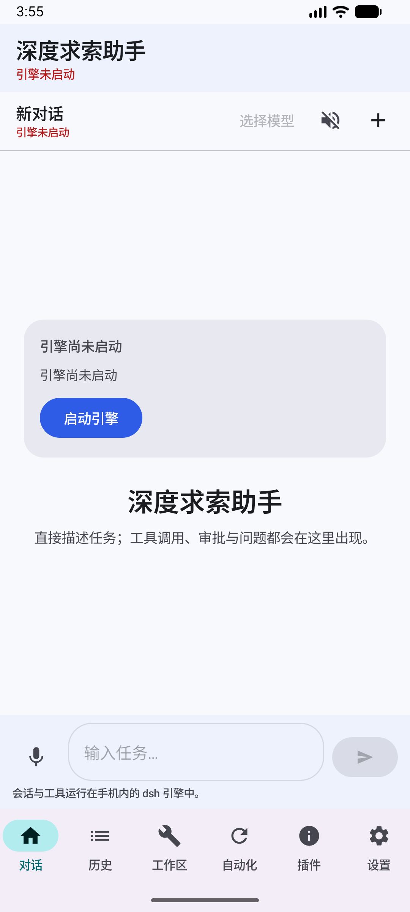

# 离线语音识别（Vosk）集成与验证

状态：2026-11-08 在 Android 模拟器（x86_64 / Android 17）完成端到端验证；工程已默认使用随附 Vosk 模型，系统 `SpeechRecognizer` 仅作回退。架构总览见[架构与实现](architecture-android.md)，功能对齐见[对齐状态](parity-status.md)。

## 1. 选型：为什么是 Vosk

候选对比（2026-11 复核，许可证与集成方式均为公开信息）：

| 框架 | 许可证 | Android 集成方式 | 中文模型 | 流式/部分结果 | 结论 |
|---|---|---|---|---|---|
| **Vosk**（[alphacep/vosk-api](https://github.com/alphacep/vosk-api)） | Apache-2.0 | Maven Central AAR `com.alphacephei:vosk-android:0.3.47`，含 arm64-v8a/armeabi-v7a/x86/x86_64 原生库，无需 NDK | `vosk-model-small-cn-0.22`，65 MiB | 支持（`onPartialResult`） | **采用**：零 native 构建、体积可控、离线、支持模拟器 x86_64 |
| [sherpa-onnx](https://k2-fsa.github.io/sherpa/onnx/android/index.html) | Apache-2.0 | 官方 AAR 未发布到 Maven Central（[PR #1615](https://github.com/k2-fsa/sherpa-onnx/pull/1615) 仍在讨论），通常需 NDK/CMake 构建或用发布包手工集成 | Zipformer/Paraformer 中文模型，识别率更高 | 支持 | 备选升级路径：精度更高，但集成/构建成本与风险显著更高 |
| whisper.cpp | MIT | 需 NDK 交叉编译 + JNI 封装 | Whisper tiny/base 中文可用 | 分段、非实时友好 | 不采用：体积大、移动端延迟高、非流式 |
| FunASR | MIT | Python 优先，无官方 Android SDK；需 ONNX 导出与自建推理层 | Paraformer 中文很强 | 支持（自建） | 不采用：工程量大，超出本次集成范围 |
| PocketSphinx | BSD | 老牌 C 库 | 中文模型效果弱 | 支持 | 不采用：精度与维护状态不满足 |

Vosk 的关键工程优势：唯一需要新增的是 Gradle 依赖 + assets 模型 + 一层 Kotlin 封装，不引入 NDK、CMake、CMake 工具链或 ABI 维护成本；模型与音频全程本机处理，不依赖 Google 语音服务（真机 PJA110 上就没有可用的系统识别服务）。

## 2. 依赖与模型

```kotlin
// app/build.gradle.kts
implementation("com.alphacephei:vosk-android:0.3.47") // Apache-2.0，传递依赖 JNA 5.13.0 (aar)
```

模型不随仓库跟踪（65 MiB），首次克隆后执行：

```sh
python3 tools/fetch_vosk_model.py      # 下载 + 校验 SHA-256 + 解压到 assets/vosk/model-cn
```

| 项 | 值 |
|---|---|
| 模型 | `vosk-model-small-cn-0.22`（[下载页](https://alphacephei.com/vosk/models)） |
| 压缩包 SHA-256 | `3af8b0e7e0f835ae9d414ce5df580237a3cfb08d586c9fbbb0f7ff29ad5b14ba`（43,898,754 B） |
| 解压后 | 68,292,307 B（65.13 MiB），15 个文件：`am/final.mdl`、`conf/*`、`graph/{Gr,HCLr}.fst`、`graph/phones/*`、`ivector/*`、`uuid`、`README` |
| 打包路径 | `app/src/main/assets/vosk/model-cn/`（由 `.gitignore` 排除） |
| 运行期路径 | `filesDir/vosk/model-cn/`（首次启动从 assets 复制，staging 目录原子替换） |

`tools/fetch_vosk_model.py` 支持 `--force`、`--keep-zip`、`--archive`；下载后强校验 SHA-256，解压时去掉 zip 顶层目录，并在缺失时补 `uuid`。

## 3. 代码结构

| 文件 | 职责 |
|---|---|
| `OfflineSpeechRecognizer.kt` | Vosk 封装：assets 检测、模型复制与 `Model` 加载、`SpeechService` 录音会话、部分/最终结果回调、`decodePcm()` 供测试离线解码 |
| `VoiceController.kt` 的 `VoiceInputController` | 统一门面：优先离线 Vosk；模型缺失时回退系统 `SpeechRecognizer`；对 UI 暴露同一组回调 |
| `ChatScreen.kt` | 未改动语义：短按填入输入框、长按识别后直发、悬浮球轻点只填不发 |
| `app/src/androidTest/.../OfflineSpeechRecognitionTest.kt` | 4 项设备级测试（模型打包、加载/幂等、中文 WAV 解码、麦克风会话启停） |

关键行为：

- 模型加载在单线程后台执行，不阻塞 UI；首次复制约 65 MiB，之后按 `am/final.mdl` 存在判断复用。
- `VoiceInputController.available()` 在“assets 模型存在”或“系统识别可用”时为真，因此无系统语音服务的设备也能启用麦克风。
- 识别结果 JSON 由 `org.json` 解析：`partial` 帧映射部分结果，`text` 帧更新草稿，`onFinalResult` 作为最终结果触发“长按直发”。
- 录音会话结束（`stop()`）会等待 Vosk 的 `onFinalResult`；出错时映射为中文提示，不崩溃。

## 4. 构建与安装

```sh
cd android-dsh
python3 tools/fetch_vosk_model.py                 # 首次：准备模型
./gradlew :app:assembleDebug                      # 需要 assets/dsh/payload.zip（真实运行时）
# 若暂时没有 dsh payload（本仓库不跟踪），仅做 UI/语音验证可跳过其校验：
./gradlew :app:assembleDebug -x checkRuntimePayload
```

模型使 debug APK 增加约 65 MiB；不包含 dsh payload 的 APK 为 115,443,132 B（110.1 MiB，2026-11-08 构建）。

## 5. 设备验证（2026-11-08，模拟器）

环境：`Medium_Phone_API_37.0`（Android 17 / API 37、x86_64、1080×2400、WHPX 加速）；Gradle 8.9 + JDK 21 + compileSdk 35；App `com.example.adsh`。

```sh
adb -s emulator-5554 install -r -t app/build/outputs/apk/debug/app-debug.apk
adb -s emulator-5554 install -r -t app/build/outputs/apk/androidTest/debug/app-debug-androidTest.apk
adb -s emulator-5554 shell pm grant com.example.adsh android.permission.RECORD_AUDIO
adb -s emulator-5554 shell am instrument -w -r \
  com.example.adsh.test/androidx.test.runner.AndroidJUnitRunner
```

结果：`OK (4 tests)`。

| 测试 | 结果 |
|---|---|
| `bundledModelIsPackagedInApk` | 通过（assets 模型存在，`VoiceInputController.available()` 为真） |
| `loadsModelIntoPrivateStorageAndIsIdempotent` | 通过（复制到 `filesDir/vosk/model-cn`，二次加载复用） |
| `decodesBundledChineseWavToText` | 通过；测试音频为 FunASR 官方示例（16 kHz/单声道/16 bit，5.547 s，SHA-256 `a1bd32dc…f4f20f`），识别输出 `欢迎 大家 来 体验 打磨 远 推出 的 语音识别 模型`（41 个部分结果） |
| `microphoneSessionStartsAndStopsWithoutCrash` | 通过（`AudioRecord` + Vosk `SpeechService` 启动/停止，回调正常，无崩溃） |

说明：测试音频原句为“欢迎大家来体验达摩院推出的语音识别模型”，小模型把“达摩院”识别为“打磨远”，属模型精度限制而非链路问题。

应用壳层验证：安装后 `MainActivity` 正常启动（约 4.2 s），对话页显示“引擎尚未启动 / 启动引擎”，底部 6 个 tab 与输入框正常；麦克风按钮在引擎未就绪时按设计禁用（`Composer(enabled = state.engineReady)`）。



模拟器为 x86_64，而随附 dsh payload 只含 arm64 的 Node ELF，**因此本模拟器上 dsh 引擎无法启动，无法做“引擎就绪 + 点麦克风说话”的整条 UI 链路验证**；语音链路已由上述 instrumentation 测试覆盖到麦克风录制层。

## 6. 已知限制

1. 小模型精度有限（同音/近音词会错，如“达摩院”→“打磨远”）；对命令式短句与常用表达够用，长句听写建议换大模型或升级 sherpa-onnx。
2. 只支持中文（`zh-CN` 小模型）；没有多语种自动切换。
3. 输出不带标点、不做逆文本规整；需要标点可再叠 Vosk 标点模型或上游处理。
4. APK 增加约 65 MiB；模型不纳入 Git，需要 `tools/fetch_vosk_model.py` 或 CI 缓存。
5. 离线识别与 dsh 引擎解耦：模型缺失时静默回退系统识别；两者都不可用时 UI 显示“当前设备没有可用的语音识别服务”。
6. 未在真机上用真实麦克风做长句回归（本次仅模拟器 + WAV 注入 + 麦克风会话启停）。

## 7. 后续方向

- 换 `vosk-model-cn-0.22`（约 1.3 GB）或迁移 sherpa-onnx 的流式 Zipformer 以提升精度。
- 加入 VAD/端点检测与标点模型，改善长句听写体验。
- 增加“语音自检”入口（复用 `decodePcm`），便于设备排障。
- 若 dsh payload 提供 x86_64 运行时，可在模拟器上完成“引擎 + 语音”全链路 UI 回归。
